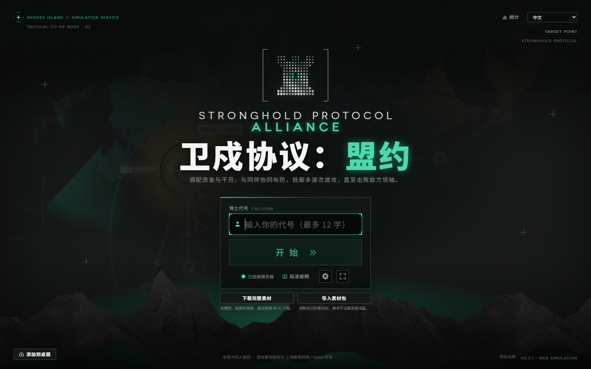
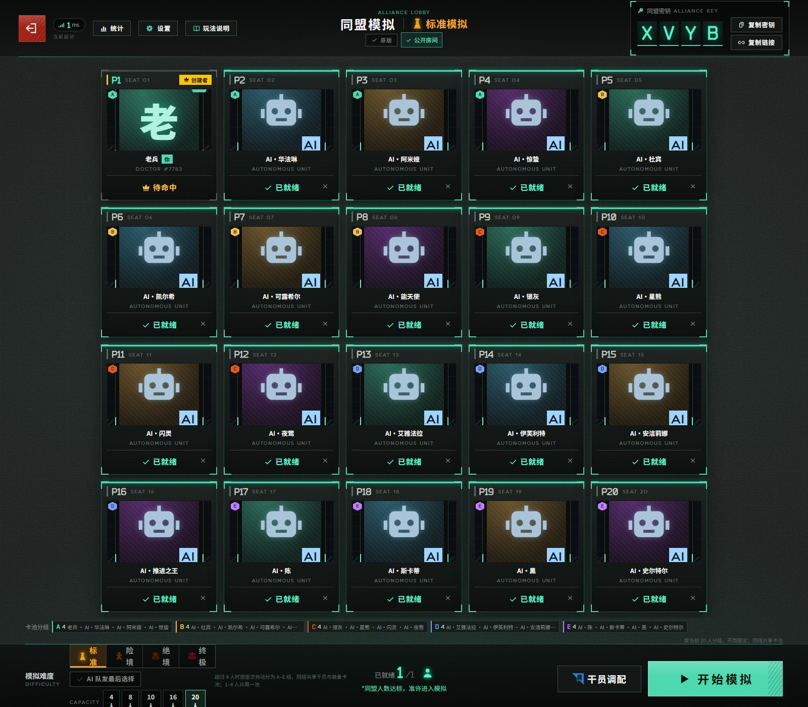
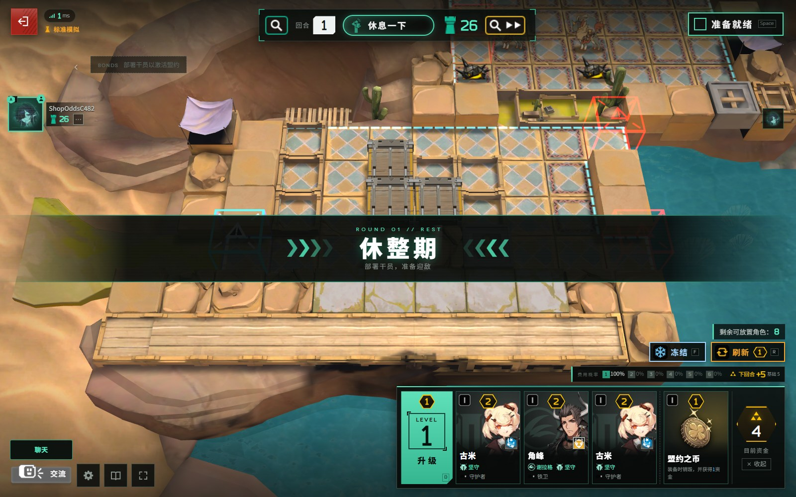
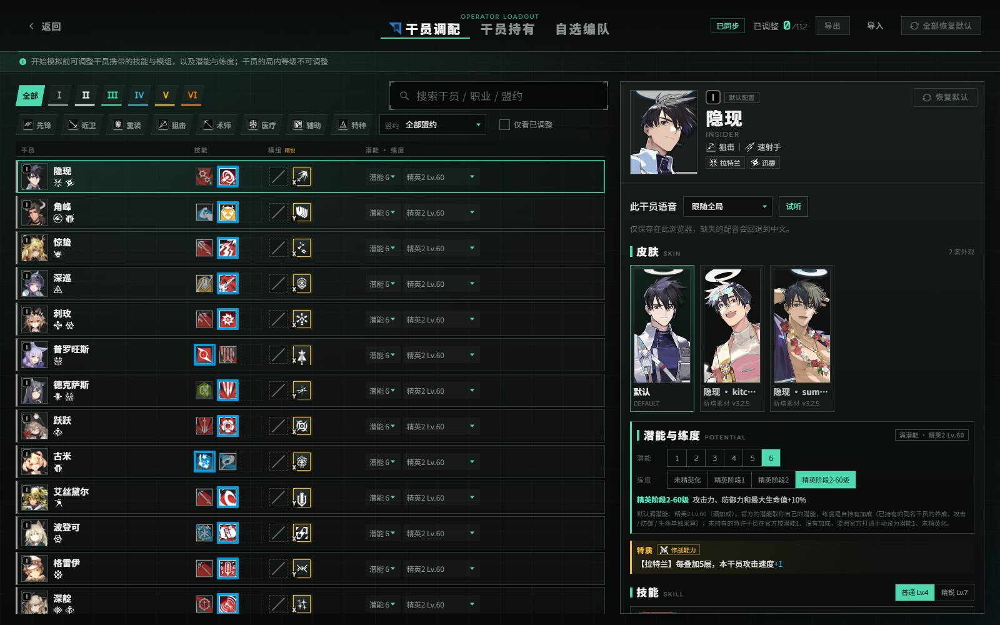
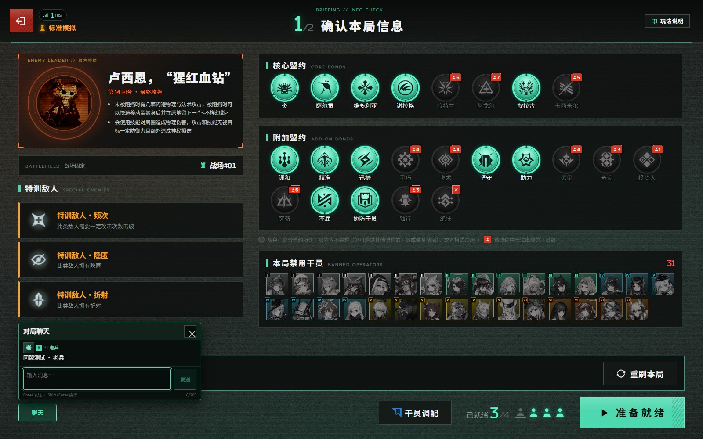

<div align="center">

# 卫戍协议：盟约

### Stronghold Protocol: Alliance · 20 人联机合作版

[](https://github.com/kskongbai/Stronghold-Protocol-Vanilla-20p/releases/latest)
[](LICENSE)
[](package.json)

浏览器即开即玩 · **内置 V3.2.5 素材包** · 单人或 **1–20 人合作** · 20 人房间 · A–E 混池 · AI 队友 · 观战席 · 商店概率 · 皮肤图鉴 · 对局聊天

[**下载完整整合包**](https://github.com/kskongbai/Stronghold-Protocol-Vanilla-20p/releases/latest) · [快速开始](#快速开始) · [更新日志](#v031-20p1--2026-10-23) · [English](#english)



</div>

> [!IMPORTANT]
> 本项目是玩家自制的**非官方同人作品**，与上海鹰角网络科技有限公司（Hypergryph）、Yostar 及其关联方没有任何关系，未获授权或认可。
>
> 《明日方舟》及「卫戍协议」相关的名称、角色、美术、音乐、音效、文本与数据等素材，版权归原权利人所有；这些素材**不适用**本项目的 GPL-3.0 许可证，GPL 只覆盖本项目自己编写的代码。
>
> **仅供学习交流与个人非商业使用，严禁任何形式的盈利**，包括售卖本项目或整合包、付费下载 / 分发、收费服务器、广告、打赏、会员等。仓库源码不包含游戏美术与音频素材；[Releases](https://github.com/kskongbai/Stronghold-Protocol-Vanilla-20p/releases/latest) 的完整包为方便玩家附带了素材，下载即视为同意本声明。完整条款见 [NOTICE.md](NOTICE.md)。

## 为什么玩这个版本

这个仓库不是简单的上游镜像：它把**龙千尘的 20 人版本**移植到 **sganggs 的 0.3.1 网页版**上，并补上了几处真正影响开黑体验的功能。

| | |
|---|---|
| **20 人同盟房间**<br>容量 4 / 8 / 10 / 16 / 20，固定 P1–P20 座位；空位可补 AI，房主可加 / 移除 AI；每个房间 2 个观战席。 | **A–E 组内混池**<br>1–4 人共用一池；5 人以上按座次分成最多 5 组，**组内共享、组间隔离**；等待室和开局信息都能看到组条。 |
| **商店概率 + 下回合收入**<br>商店下方实时显示各费用出现概率、下回合基础收入、已锁定资金和预计总收入，不用再凭感觉刷新。 | **皮肤图鉴 + 语音试听**<br>干员调配右栏列出全部皮肤；语音可按「跟随全局」或单独选择，缺少的配音回退中文。 |
| **对局聊天 + 表情**<br>独立「聊天」入口、未读计数和最近消息浮层；6 套 × 6 个表情，AI 队友也会回应。 | **手机 / 平板 / 桌面自适应**<br>手机横屏 16:9；≥900px 的平板横屏和桌面使用全屏布局，等待室按钮不会被挤出屏幕。 |

## 内置最新 V3.2.5 素材包

本仓库的 **v0.3.1-20p.1 整合包**已经放入最新的 **V3.2.5 完整素材包（完整修正版）**。干员立绘、皮肤、模型、语音、技能图标与关卡素材随包提供，解压后直接启动即可，不需要再运行 `npm run setup`，也不需要进入游戏后另行下载素材。

- **发行包**：`public/assets/` 已经是 V3.2.5 素材，和 0.3.1 的代码、20 人改动一起打好包。
- **源码**：GitHub 源码仓库仍然不附带游戏美术与音频；从源码运行才需要 `npm run setup`。
- **升级方式**：直接下载最新整合包，整包替换旧目录；不要只替换 `public/assets/`，以免素材与代码版本不一致。

> V3.2.5 是素材包版本，0.3.1 是本项目所基于的网页版代码版本；两者不是同一个版本号。

## 20 人同盟房间



- 座位号固定为 **P1–P20**，空位不会把后面的座位号往前压。
- 5 人以上自动按座次分成 **A–E** 组；组内共享干员库存，组间隔离，避免 20 人抢同一张卡。
- `AI` 是补位队友，`创建者` 是房主，`你` 是当前浏览器对应的玩家；每个房间另有 **2 个观战席**。
- 同盟密钥是 4 位字母，也可以直接复制 `?room=密钥` 邀请链接。

## 商店概率与下回合收入



商店下方新增一条预测栏：

- **费用概率**：当前商店等级下，1–6 费干员各自的出现概率。
- **下回合收入**：基础收入、已锁定 / 待发放资金、预计总资金。
- 概率由当前商店等级和池子权重实时计算；拿到改变经济或商店的策略后，实际结果仍可能不同。

## 干员皮肤与语音



- 每名干员的全部皮肤列在右栏，默认皮肤、活动皮肤和新素材皮肤分别标注。
- 「此干员语音」可选择跟随全局或单独指定；点击「试听」立即播放。
- 语音设置只保存在当前浏览器，不会改别人的客户端。

## 对局聊天



- 进入对局后在左下角打开「聊天」；支持文字消息、Enter 发送、Shift+Enter 换行、未读计数和最近消息浮层。
- 消息只保存在本局内存里，不写浏览器记录；观战席也能看到并参与。
- 表情面板在「交流」里：6 套主题 × 6 个表情，发送后气泡出现在对应玩家头像旁。

## 快速开始

### 方式一：下载完整整合包（推荐）

1. 打开 [Releases](https://github.com/kskongbai/Stronghold-Protocol-Vanilla-20p/releases/latest)，下载 **`Stronghold-Protocol-Vanilla-20p-v0.3.1-20p.1.zip`**。
2. 解压到路径较短的文件夹（Windows 上建议不要放在 OneDrive 同步目录里）。压缩包内已套一层 `Stronghold-Protocol-Vanilla-20p/` 文件夹。
3. 安装 **Node.js 22 或 24（LTS）**：Windows 可在 PowerShell 运行 `winget install OpenJS.NodeJS.LTS`，或到 <https://nodejs.org/zh-cn/download> 下载；macOS / Linux 用发行版包管理器、nvm 或 fnm。
4. 启动：
   - **Windows**：双击根目录的 **`启动服务器.bat`**。如果弹出安全警告，点「运行」；防火墙弹窗请允许「专用网络」。
   - **macOS / Linux**：在根目录运行 `bash 启动服务器.sh`（或 `chmod +x 启动服务器.sh && ./启动服务器.sh`）。
5. 浏览器打开 <http://localhost:3000>。启动窗口会列出局域网地址，直接发给同一 Wi-Fi 的朋友即可。

> 整合包已经包含 **最新 V3.2.5 素材包**、`public/assets/` 和运行依赖，首次启动不需要再下载素材。换端口：`启动服务器.bat --port 3001` 或 `bash 启动服务器.sh --port 3001`。

### 下载校验（SHA-256）

发行页同时提供 **`SHA256SUMS.txt`**。它是一份**校验清单**，不是启动文件，也不用解压：文件里每行记录压缩包的 SHA-256 摘要和文件名。下载完 ZIP 后，在文件所在目录计算一次 SHA-256，与清单中的值对照；一致说明文件完整、没有在下载或传输中损坏，也没有被替换。

```powershell
# Windows PowerShell
Get-FileHash .\Stronghold-Protocol-Vanilla-20p-v0.3.1-20p.1.zip -Algorithm SHA256
```

```bash
# macOS / Linux
sha256sum Stronghold-Protocol-Vanilla-20p-v0.3.1-20p.1.zip
```

当前发行版的校验文件：[SHA256SUMS.txt](https://github.com/kskongbai/Stronghold-Protocol-Vanilla-20p/releases/download/v0.3.1-20p.1/SHA256SUMS.txt)。

### 方式二：从源码运行

```bash
git clone https://github.com/kskongbai/Stronghold-Protocol-Vanilla-20p.git
cd Stronghold-Protocol-Vanilla-20p
npm install        # 安装依赖
npm run setup      # 下载约 720 MB 美术 / 音频（可中断续传）
npm start          # http://localhost:3000
```

源码仓库**不包含**游戏美术与音频；从源码运行需要 `npm run setup` 下载素材。完整整合包则已经把素材和依赖一起打包。

### 和朋友一起玩

1. 打开页面 → 输入代号 → **同盟模拟** → 创建房间，选择 4 / 8 / 10 / 16 / 20 人。
2. 把 4 位**同盟密钥**或「复制链接」得到的 `http://<地址>:3000/?room=密钥` 发给朋友。
3. 所有人「准备就绪」后，房主点「开始模拟」。
4. 同一局域网用启动窗口里的 `http://192.168.x.x:3000`；跨网络可以用虚拟局域网、隧道或 VPS，详见 [docs/DEPLOY.md](docs/DEPLOY.md)。

<details>
<summary><strong>展开：相对上游 0.3.1 的构建改动</strong></summary>

| 改动 | 状态 | 说明 |
|---|---|---|
| 20 人容量与 4 / 8 / 10 / 16 / 20 房间 | 已加入 | 按座次均衡分组，最多 5 组；20 人为 4+4+4+4+4 |
| 组内混池（A–E） | 已加入 | 组内共享干员库存；各组库存彼此隔离 |
| AI 队友与「AI 队友最后选择」 | 已加入 | 空位补 AI；策略 / 机变时可让真人先选 |
| 观战席 | 已加入 | 最多 2 人；等待室与对局中均可观战 |
| 商店概率与下回合收入 | 已加入 | 商店下方实时预测，见上方截图 |
| 干员皮肤图鉴与语音试听 | 已加入 | 右栏列出皮肤；语音可跟随全局或单独设置 |
| 对局聊天与表情 | 已加入 | 临时消息、未读计数、6×6 表情 |
| 手机 / 平板 / 桌面适配 | 已加入 | 手机横屏 16:9；≥900px 平板横屏与桌面全屏 |
| 重复席位清理、踢人修复 | 已加入 | 重复的玩家 / 观战席位会在服务端去重；踢人只影响目标 |
| 插件与管理员后台 | 已移除 / 关闭 | 这是 `Vanilla-20p` 的构建选择 |
| 官方账号、官方进度、官方商城 | 不提供 | 非官方自建服务器 |

</details>

## v0.3.1-20p.1 — 2026-10-23

这是本仓库的**第一个正式发行版**。

- **20 人合作**：房间容量 4 / 8 / 10 / 16 / 20；P1–P20 固定座位；AI 补位；2 个观战席。
- **A–E 组内混池**：5 人以上按座次分组，组内共享、组间隔离。
- **商店信息增强**：费用概率、下回合基础收入、待发放资金、预计总资金。
- **皮肤与语音**：干员调配右栏皮肤图鉴；语音试听，缺失配音回退中文。
- **对局聊天**：文字消息、未读计数、最近消息浮层；6 套 × 6 表情。
- **屏幕适配**：手机横屏 16:9；平板横屏 / 桌面全屏，大厅与等待室铺满视口。
- **一键启动**：Windows `启动服务器.bat`，macOS / Linux `启动服务器.sh`。
- **整合包**：已放入最新 **V3.2.5 完整素材包**和运行依赖，解压即用；源码仓库不附带素材。

完整历史见 [CHANGELOG.md](CHANGELOG.md)。本次发行的详细说明见 [发行说明.md](发行说明.md)。

## 文档

| 文档 | 内容 |
|---|---|
| [CHANGELOG.md](CHANGELOG.md) | 全部版本的更新记录 |
| [docs/PLAYING.md](docs/PLAYING.md) | 玩法指南：流程、经济、招募、摆阵、盟约、结算 |
| [docs/DEPLOY.md](docs/DEPLOY.md) | 部署：Windows 开服、防火墙、组网、反向代理与 HTTPS、Docker |
| [docs/SKINS.md](docs/SKINS.md) | 皮肤与立绘的目录、命名和接入说明 |
| [docs/PLUGINS.md](docs/PLUGINS.md) · [docs/PLUGIN-GUIDE.md](docs/PLUGIN-GUIDE.md) | 插件格式、安装与工作台入门 |
| [NOTICE.md](NOTICE.md) | 素材版权、分发限制与 GPL 附加许可 |
| [THIRD-PARTY-NOTICES.md](THIRD-PARTY-NOTICES.md) | 第三方组件与许可证 |

## 上游与致谢

本仓库基于以下两个上游项目，代码、素材、文档和许可证分别归各自作者与权利人所有：

1. **[LongQianChen/Stronghold-Protocol](https://github.com/LongQianChen/Stronghold-Protocol)** — 20 人版本相关实现与探索；本项目的 20 人房间、AI 队友和多人容量适配以此为基础之一。
2. **[sganggs/Stronghold-Protocol](https://github.com/sganggs/Stronghold-Protocol)** — 0.3.1 网页版；网页端基础、规则 / 界面、服务端与战斗模拟以此为基础。

游戏数据来自 [Kengxxiao/ArknightsGameData](https://github.com/Kengxxiao/ArknightsGameData)；素材来自 [yuanyan3060/ArknightsGameResource](https://github.com/yuanyan3060/ArknightsGameResource)、[fexli/ArknightsResource](https://github.com/fexli/ArknightsResource)、[isHarryh/Ark-Models](https://github.com/isHarryh/Ark-Models)、[ArknightsAssets/ArknightsAssets2](https://github.com/ArknightsAssets/ArknightsAssets2)；规则核对参考 [PRTS](https://prts.wiki/)。感谢所有作者与维护者。

## 许可证

- **代码**：本项目自己编写的代码以 **GPL-3.0-or-later** 发布，全文见 [LICENSE](LICENSE)；另附 GPL 第 7 条附加许可，允许与 pixi-spine 中的 Spine Runtimes 组合分发，见 [NOTICE.md](NOTICE.md)。
- **游戏素材不在许可范围内**：所有《明日方舟》相关素材版权归原权利人所有，不适用 GPL；限制见上方声明与 [NOTICE.md](NOTICE.md)。
- **第三方组件**：通过 npm 安装的库、`tools/local-extract/aklz4.py`（BSD-3-Clause）、字体等分别遵循各自许可证，详见 [THIRD-PARTY-NOTICES.md](THIRD-PARTY-NOTICES.md)。

## 贡献

欢迎提 Issue 反馈 bug、规则差异或改进建议，也欢迎 Pull Request。提交前请运行 `npm test`，不要提交 `public/assets/` 下的游戏素材，不要加入广告、付费、打赏等变现功能。

本项目按「现状」提供，不提供任何担保，使用风险自负。权利人如认为本项目侵犯其权益，请通过 Issue 联系，我们会立即删除相关内容。

---

## English

An **unofficial, non-commercial fan remake** of Arknights' seasonal auto-chess tower-defense mode *Stronghold Protocol: Alliance*, playable in the browser: solo or **1–20 player co-op** (rooms of 4 / 8 / 10 / 16 / 20; AI teammates fill empty seats; two spectator slots).

This fork adds a 20-player room layout, A–E shared card pools, shop odds and next-round income forecasts, a skin gallery with voice previews, in-match chat with emotes, and responsive phone / tablet / desktop layouts on top of the sganggs 0.3.1 web version.

**Run the full bundle:** download the latest ZIP from [Releases](https://github.com/kskongbai/Stronghold-Protocol-Vanilla-20p/releases/latest), install Node.js 22 or 24, then double-click `启动服务器.bat` (Windows) or run `bash 启动服务器.sh` (macOS / Linux), and open <http://localhost:3000>. From source: `npm install && npm run setup && npm start`.

**Disclaimer:** not affiliated with or endorsed by Hypergryph or Yostar. All Arknights names, art, audio, text and data are © their respective owners and are **not** covered by this project's GPL licence. For study and personal non-commercial use only — no selling, paid distribution, paid servers or monetisation. Content will be removed on request of the rights holders. Provided “as is”, without warranty.
